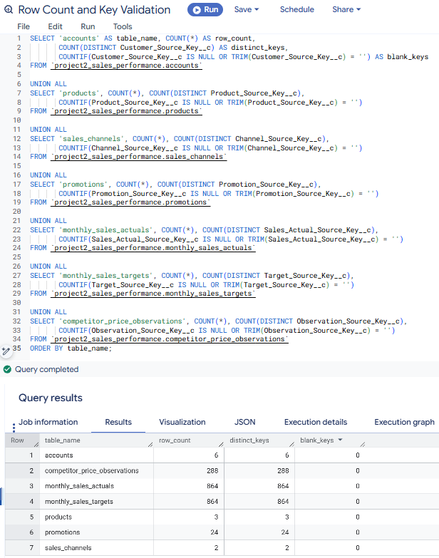
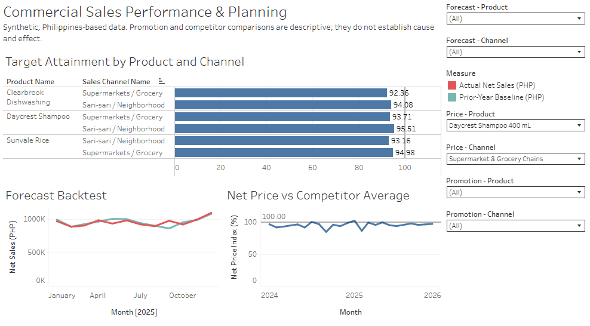
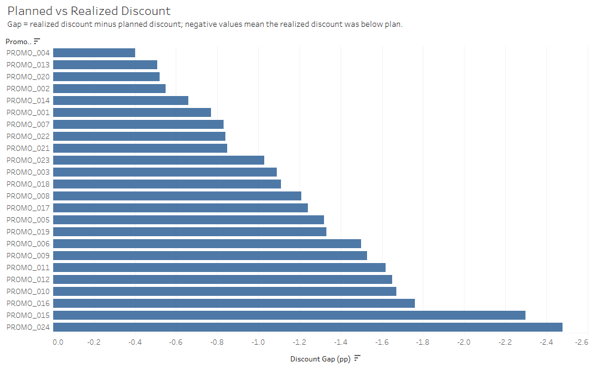

# Commercial Sales Performance & Planning — Case Study

> This project uses synthetic, Philippines-based data for a fictional distributor. Its results demonstrate an analytics workflow; they do not establish real business outcomes or cause and effect.

## Project Overview

I built an end-to-end sales analytics project to examine performance against targets, changes in sales and gross margin, promotion discount execution, competitor price observations, and a simple sales forecast baseline.

The 2024–2025 datasets represent a fictional food and household-products distributor. I set up the initial account and sales-channel records with Salesforce’s Data Import Wizard. I used Salesforce Data Loader for later bulk imports and a promotion update, then exported the Salesforce records to CSV. I then profiled and cleaned the exports with Excel Power Query, used Excel VBA to run quality checks and export the cleaned tables, analyzed those tables with SQL in BigQuery, and presented selected results in Tableau Public.

This case study explains the main workflow, decisions, checks, and outputs. The project README provides the shorter overview and links to the dashboard and supporting files.

## 1. Generate the Seed Records

- **Goal:** Create a small, consistent set of fictional customers, products, and sales channels to establish the project’s Salesforce records and relationships.
- **What I did:** Used Python with NumPy and pandas to generate six customers, three products, and two sales channels. Stable source keys helped identify the same records across files. After loading the base records into Salesforce, I used Salesforce record IDs when preparing related promotions and sales data.
- **Key check:** Confirmed the expected record counts and matched the source keys to Salesforce IDs before preparing related records.
- **Output:** Salesforce records and related synthetic data for the fictional distributor. The seed files supported the Salesforce setup; the analytical input files were later exported from Salesforce.

## 2. Set Up the Salesforce Data

- **Goal:** Store the fictional distributor’s records in Salesforce and connect related information.
- **What I did:** In Salesforce Developer Edition, I set up records for customers, products, sales channels, promotions, monthly sales, monthly targets, and competitor price observations. I used the Data Import Wizard for the initial account and sales-channel imports, then used Data Loader for later bulk imports and the promotion update. I added lookup fields so related records could be connected.
- **Key check:** Checked the import results and record counts: 6 customers, 3 products, 2 sales channels, 24 promotions, 864 monthly sales records, 864 monthly target records, and 288 competitor price observations.
- **Output:** Connected Salesforce records that I later exported as the source files for the analysis.

## 3. Export the Salesforce Data

- **Goal:** Create the source files for cleaning and analysis while retaining the links between records.
- **What I did:** Used Salesforce Data Loader to export seven record groups to CSV: accounts, products, sales channels, promotions, monthly sales actuals, monthly sales targets, and competitor price observations. I saved the files in data/salesforce-exports/.
- **Key check:** Confirmed the export row counts matched the Salesforce records and that the files retained the IDs used to connect related records.
- **Output:** Seven raw Salesforce export files for Power Query. The Python seed files supported the Salesforce setup; they were not the files loaded into BigQuery.

## 4. Profile and Clean the Salesforce Exports

- **Goal:** Understand the exported data before changing it, then correct issues that could affect the analysis.
- **What I did:** Loaded the seven Salesforce CSV exports into Excel Power Query. I checked row counts, data types, missing values, key uniqueness, date ranges, and relationships. The checks revealed six different competitor-name spellings for two competitors and three missing competitor prices. I standardized the names and kept the prices blank because there was no evidence to replace them with reliable values. I also confirmed that blank promotion links on monthly sales records meant “no promotion,” rather than missing sales data.
- **Key check:** Confirmed that the cleaned tables retained their expected row counts and that the promotion-link status showed 720 records with no promotion and 144 linked to a promotion.
- **Output:** Seven cleaned tables, with the missing competitor prices preserved for review rather than filled with guesses.

## 5. Check and Export the Clean Tables with VBA

- **Goal:** Confirm that all seven cleaned tables were complete and ready to load into BigQuery.
- **What I did:** Updated an Excel VBA macro to refresh the Power Query results, compare actual row counts and unique keys with the expected values, run project-specific checks, and export the tables as CSV files to `data/power-query-cleaned/`.
- **Key check:** The QA summary reported PASS for all seven tables. It also confirmed that all 864 monthly sales records passed the financial check, 720 had no promotion and 144 were promotion-linked, and the competitor data contained three missing prices and two standardized competitor names.
- **Output:** Seven cleaned CSV files, ready for BigQuery.

## 6. Load and Validate the Clean Tables in BigQuery

- **Goal:** Confirm that the cleaned Salesforce exports loaded correctly and that the related records still matched.
- **What I did:** Created the project dataset in BigQuery Sandbox and loaded the seven cleaned CSV files as tables. I checked the table fields and row counts, then used SQL to check unique keys, missing links, and whether monthly sales and target records matched on customer, product, sales channel, and month.
- **Key check:** All seven tables had the expected row counts and unique keys. The relationship checks found no unmatched records, and all 864 sales records matched a target at the same customer, product, channel, and month.
- **Output:** Validated BigQuery tables ready for analysis.

*All seven tables had the expected row counts and distinct keys, with no blank source keys.*

## 7. Analyze Commercial Performance with SQL

- **Goal:** Turn the validated tables into measures that answer the project’s business questions.
- **What I did:** Used BigQuery SQL to compare sales with targets, calculate gross-margin and year-over-year changes, review promotion discount gaps and related sales patterns, compare our prices with available competitor readings, and backtest a simple 2025 forecast using the matching months from 2024.
- **Key decision or check:** Kept three missing competitor prices blank and excluded one unverified price reading from the comparison while retaining its source record. Treated the promotion and competitor comparisons as descriptive patterns, not proof that one factor caused another.
- **Output:** Four summary CSVs for the dashboard: target attainment, forecast backtest, competitor price comparison, and planned-versus-realized promotion discounts.

## 8. Present Selected Results in Tableau Public

- **Goal:** Give recruiters and business readers a clear way to explore the main results.
- **What I did:** Built a Tableau Public dashboard with four views: target attainment by product and channel, the 2025 forecast backtest, net price compared with the competitor average, and planned versus realized promotion discounts. I added filters so readers can focus on a product and channel in the relevant views.
- **Key check:** Compared chart values with the four BigQuery summary files and confirmed the published dashboard opens publicly.
- **Output:** [View the Commercial Sales Performance & Planning dashboard](https://public.tableau.com/app/profile/rodolfo.flores4240/viz/CommercialSalesPerformancePlanning/CommercialSalesPerformancePlanning?publish=yes)

*The overview presents selected performance measures from the analysis.*

*The promotion view compares the recorded discount measures; the relationship is descriptive.*

## Findings

The dashboard shows four selected views of the analysis. The findings below also include results from SQL summaries that are not displayed as dashboard charts.

- **Sales were below target across all six product and channel combinations.** Net sales totaled ₱22.85 million against ₱24.27 million in targets, or 94.12% attainment. The dashboard shows the attainment rate for each combination; it does not show these overall peso totals.
- **Year-over-year results differed by product and channel.** Rice net sales rose slightly in Supermarkets & Grocery Chains, while its gross-margin rate fell by 1.05 percentage points. Clearbrook Dishwashing Liquid in that channel had the largest year-over-year declines in net sales (4.05%) and gross-margin rate (3.08 percentage points). These comparisons are in the SQL results, not the dashboard.
- **The measured realized discount was below the planned discount for all 24 promotions.** The dashboard shows these gaps. In the SQL analysis, promotion-linked customer-months also had lower average sales, target attainment, and gross-margin rates than non-promotion months in each product and channel combination. These are descriptive comparisons and do not show that promotions caused the differences.
- **Observed net prices were below the available competitor average in 134 of 144 comparisons.** The comparison excluded one unverified competitor reading; 12 comparisons had only one available reading. The dashboard shows the price-index trend, but not these overall counts.
- **The 2025 forecast baseline had weighted absolute percentage error (WAPE) between 3.88% and 8.56%** across the six product and channel combinations. WAPE summarizes forecast error relative to actual sales. The dashboard compares the actual and baseline sales lines but does not display WAPE.

## Recommendations

These are investigation steps suggested by the synthetic results. They are not instructions to change real sales or pricing decisions.

1. **Review the largest target gaps first.** Start with Sunvale Rice, which had the largest peso shortfalls against target, and Clearbrook Dishwashing Liquid in Supermarkets & Grocery Chains, which had the lowest attainment rate. These are clear places to investigate the gap drivers.
2. **Look at margin alongside sales.** Review Rice in Supermarkets & Grocery Chains, where net sales rose slightly while gross-margin rate fell, and Clearbrook Dishwashing Liquid in that channel, where both measures declined. This can help distinguish sales growth from profitable growth.
3. **Check promotion definitions before judging execution.** Confirm how planned and realized discount percentages are defined and calculated. The observed gaps and promotion-linked sales patterns are descriptive, so they do not prove that promotions caused the results.
4. **Improve competitor-price evidence before using it for pricing decisions.** Review the excluded unverified reading and seek more than one reliable competitor price for each comparison where possible.
5. **Use the forecast as a starting benchmark.** Compare the prior-year-same-month baseline with other simple methods and test across more years before using it for planning.

## Limitations

- The data is synthetic. It represents only six customers, three products, two sales channels, and 24 months, so it does not represent a real distributor’s scale or behavior.
- Promotion-linked and non-promotion results are descriptive comparisons, not evidence that promotions caused the differences. The planned and realized discount measures also need to be confirmed against real business definitions.
- Competitor coverage is limited to two synthetic competitors. Three prices were missing, one reading was excluded as unverified, and 12 product–channel–month comparisons had only one available competitor reading.
- The forecast backtest covers one year, 2025, using the corresponding 2024 months as the baseline. It is a simple benchmark, not a validated operating forecast.
- The results should be checked against broader, verified business data before they are used to make operational decisions.
