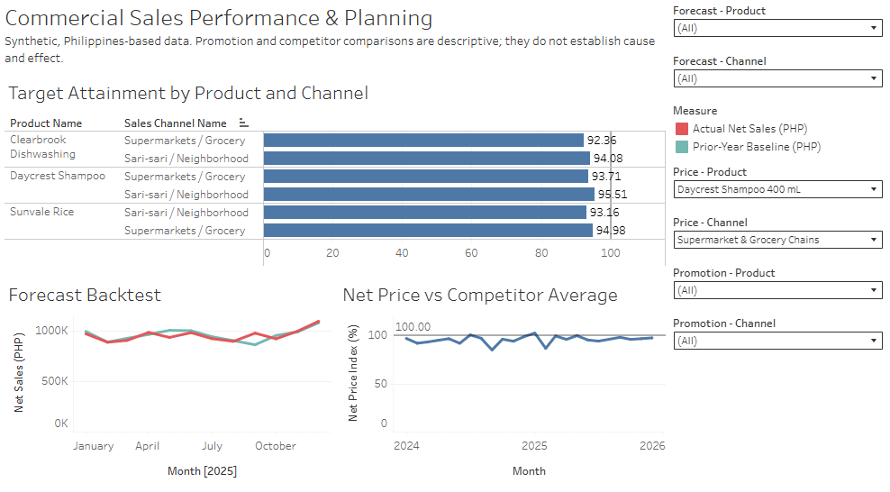
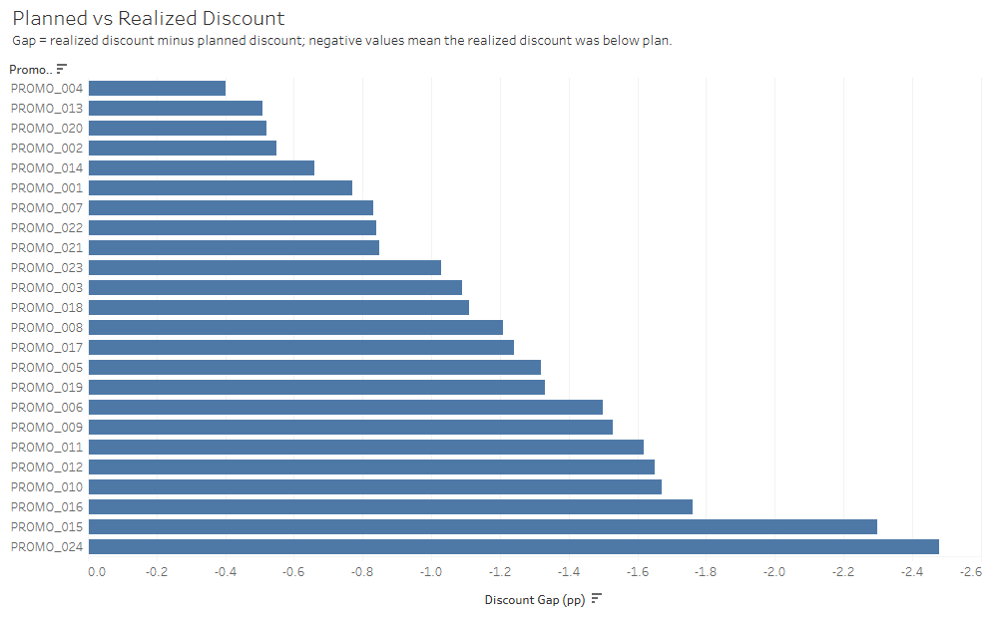

# Commercial Sales Performance & Planning

## Project Overview

I built a synthetic, Philippines-based sales performance project for a fictional food and household-products distributor. The project brings together sales actuals, targets, products, customers, sales channels, promotions, and competitor price observations to examine commercial performance and identify areas for further review.

The workflow begins with synthetic data generated using Python, NumPy, and pandas. I loaded the related records into Salesforce, exported them, profiled and cleaned the data in Excel Power Query, and used Excel VBA to run quality checks and export the approved tables. I then loaded the tables into BigQuery for SQL analysis and created a Tableau dashboard to present the results.

The analysis includes performance against sales targets, gross margin, a prior-year-month forecast baseline backtest, promotion discount execution, and descriptive price comparisons with synthetic competitors. These results use synthetic data; promotion and competitor comparisons are descriptive and do not establish cause and effect.

**Interactive Tableau dashboard:** [Commercial Sales Performance & Planning](https://public.tableau.com/app/profile/rodolfo.flores4240/viz/CommercialSalesPerformancePlanning/CommercialSalesPerformancePlanning?publish=yes)

## Dashboard Preview

The dashboard is interactive. Select a preview image to open it on Tableau Public.

*Overview: target attainment, the 2025 forecast backtest, and competitor price comparisons.*

*Promotion discount gaps. Negative values indicate that the measured realized discount was below plan.*

## Business Questions

1. How did actual net sales compare with targets across products and sales channels?
2. Where did changes in sales coincide with changes in gross margin?
3. How did promotion discount execution compare with plan, and what sales, target-attainment, and margin patterns appeared alongside promotions?
4. How did our observed net prices compare with the available synthetic competitor price readings by product, channel, and month?
5. How accurately did a prior-year-same-month baseline forecast 2025 net sales?

The analyses are intended to identify areas for review and demonstrate the use of commercial performance measures. Promotion and competitor comparisons are descriptive and do not establish cause and effect.

## Data and Tools

The project uses synthetic, Philippines-based records for a fictional food and household-products distributor. The seven datasets cover customers, products, sales channels, promotions, monthly sales actuals, monthly sales targets, and competitor price observations.

- **Python, NumPy, and pandas:** Generated repeatable synthetic seed data and prepared records for Salesforce.
- **Salesforce Developer Edition:** Stored the customer, product, sales-channel, promotion, sales, target, and competitor-observation records.
- **Salesforce Data Import Wizard and Data Loader:** The Import Wizard handled the initial account and sales-channel imports. Data Loader handled later bulk imports and the promotion update, then exported the seven Salesforce datasets to CSV for the analysis.
- **Excel Power Query:** Profiled, inspected, and cleaned the exported data.
- **Excel VBA:** Refreshed the queries, checked row counts and keys, ran project-specific quality checks, and exported the approved tables.
- **BigQuery Sandbox and SQL:** Loaded the cleaned tables, validated relationships and data grain, and calculated the performance, promotion, price-comparison, and forecast metrics.
- **Tableau Public:** Presented the analysis in a publicly accessible interactive dashboard.
- **AI assistance:** Helped draft and troubleshoot code, SQL, and documentation. I reviewed the outputs and checked them against the project’s validation results.

## Supporting Files

- [BigQuery SQL queries](sql/) include the data checks, analysis, competitor-price review, and forecast backtest used in this project. They reference the project tables in BigQuery.
- [Dashboard data exports](dashboard-data/) contain the four synthetic, dashboard-ready CSVs used in Tableau. These are analysis outputs, not the original Salesforce exports.
- [Python synthetic data seeder](python/generate_seed_data.py) uses NumPy and pandas to prepare synthetic records for Salesforce. The analytical inputs were exported from Salesforce and then loaded into BigQuery.

### Salesforce exports and cleaned data

- [Salesforce export inputs](data/salesforce-exports/) contains the seven synthetic CSV exports used as Power Query sources.
- [Power Query cleaned tables](data/power-query-cleaned/) contains the seven cleaned CSVs exported by the workbook and loaded into BigQuery.

### Excel Power Query and VBA workbook

[Download the workbook](Project2_Power_Query_Workbook_Public.xlsm). It contains the Power Query steps, QA summary, and refresh/export macro.

To refresh it, download and extract the repository, then set the `pRepoRootFolder` parameter to the extracted repository root—the folder containing `README.md` and `data`. Refresh the queries and run `RefreshQAAndExportCleanCSVs` to export the cleaned tables to `data/power-query-cleaned`. The workbook uses synthetic data.

## Methodology

1. **Generate the synthetic source records.** I used Python, NumPy, and pandas to create seed records with stable source keys for the fictional customers, products, sales channels, promotions, and sales data.

2. **Set up and populate Salesforce.** I loaded the initial account and sales-channel records with Salesforce’s Data Import Wizard, then used Data Loader for later bulk imports and the promotion update. Salesforce record IDs connected related customers, products, channels, and promotions.

3. **Export the Salesforce data.** I used Data Loader to export accounts, products, sales channels, promotions, monthly sales actuals, monthly sales targets, and competitor price observations to CSV. These Salesforce exports—not the original Python seed files—were the inputs to Power Query and, after cleaning, BigQuery.

4. **Profile and clean the exports.** In Excel Power Query, I checked row counts, data types, missing values, key uniqueness, and relationships. The checks surfaced issues such as inconsistent competitor names and three missing competitor prices. I standardized the names and retained the missing prices as missing rather than filling them with guesses. A separate competitor reading was later flagged as an unverified price reading and excluded from the price comparison; its source record was retained.

5. **Run quality checks and export the clean tables.** I used Excel VBA to refresh the queries, check expected row counts and unique keys, run project-specific checks, and export the approved tables.

6. **Load and validate in BigQuery.** I loaded the seven cleaned Salesforce-export tables into BigQuery Sandbox. SQL checks confirmed the expected row counts and unique keys, matched the actuals and targets at their customer–product–channel–month grain, and found no unmatched lookup IDs.

7. **Analyze performance in SQL.** I calculated net sales, target attainment, gross margin, promotion discount gaps, descriptive competitor price indices, and a 2025 forecast backtest using the matching month in 2024 as the baseline.

8. **Present the results in Tableau Public.** I built an interactive dashboard for target attainment, the forecast backtest, competitor price comparisons, and promotion discount execution. The dashboard is published publicly using synthetic data.

## Findings

- **Sales were below target across all six product–channel combinations** over the two-year period. Actual net sales were **₱22.85 million** against a target of **₱24.27 million**, or **94.12% attainment**. Attainment ranged from **92.36% to 95.51%**. Dishwashing Liquid in Supermarkets & Grocery Chains had the lowest attainment rate; Sunvale rice had the largest peso shortfalls in both channels.
- **Sales and gross-margin trends varied by product and channel.** Shampoo sales increased in both channels and its margin rate also rose. Rice sales increased slightly in Supermarkets & Grocery Chains, but its margin rate fell by **1.05 percentage points**. Dishwashing Liquid in Supermarkets & Grocery Chains had the largest year-over-year declines in both net sales (**4.05%**) and gross-margin rate (**3.08 percentage points**).
- **Measured realized discount percentages were below planned discounts for all 24 promotions.** Promotion-linked customer-months also had lower average sales, target attainment, and gross-margin percentages than non-promotion customer-months in each product–channel combination. These are descriptive patterns, not evidence that promotions caused the differences. The planned and realized discount measures should be checked against their business definitions before treating the gaps as execution failures.
- **Observed net prices were below the available competitor average in 134 of 144 product–channel–month comparisons.** The comparison excludes one unverified competitor price reading. Twelve of the 144 comparisons used only one available competitor reading.
- **The prior-year-same-month baseline provided a useful benchmark for 2025 sales.** WAPE ranged from **3.88% to 8.56%** across the six product–channel combinations. This is a one-year synthetic backtest of a simple baseline, not a validated operational forecast.

## Recommendations

1. **Investigate the biggest sales gaps first.** Review Sunvale rice in both channels because it had the largest peso shortfalls against target. Separately examine Dishwashing Liquid in Supermarkets & Grocery Chains, which had the lowest attainment percentage.
2. **Review margin pressure before changing prices or discounts.** Start with rice, where margin rate declined despite slight sales growth in one channel, and Dishwashing Liquid in Supermarkets & Grocery Chains, where both sales and margin rate fell most year over year.
3. **Validate promotion measures and records before changing promotion plans.** Confirm how planned discounts and realized discount percentages are defined, then compare them with real promotion records. Use a controlled test with real data before making causal claims about promotion impact.
4. **Improve competitor-price validation.** Investigate the unverified reading and obtain a second competitor observation where possible before using these comparisons to make pricing decisions.
5. **Treat the prior-year baseline as a reference point.** Compare it with other simple forecasting approaches and backtest on more periods before using it for planning.

## Limitations

The data is synthetic and represents only six customers, three products, two sales channels, and 24 months. Promotion comparisons are observational, competitor coverage is limited, and the forecast backtest covers one test year. Results should be validated with real, broader business data before operational decisions are made.

## Conclusion

This project demonstrates an end-to-end sales analytics workflow, from Salesforce records and Excel quality checks through BigQuery analysis and Tableau reporting. In the synthetic 2024–2025 sample, net sales reached 94.12% of target, while performance and margin trends varied across products and channels. The promotion and competitor comparisons identify areas for further review but do not prove causes. Real business decisions would require validated company data, broader competitor coverage, and controlled promotion testing.
